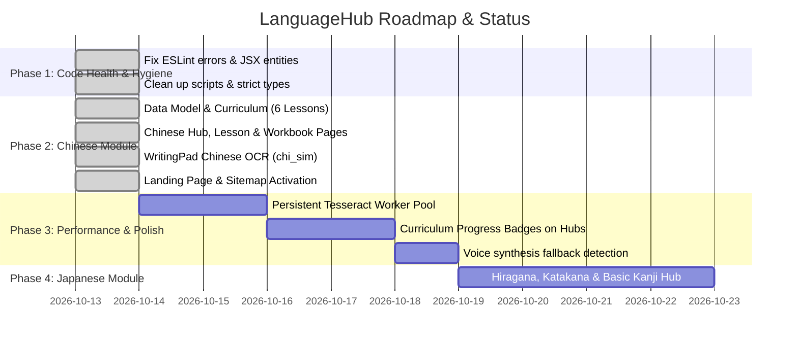

# LanguageHub — Codebase Review & Action Plan (AP)

> **Document Type:** Codebase Review, Action Plan & Module Specification  
> **Project:** LanguageHub (`ChaoprayaSoft/LanguageHub`)  
> **Date:** October 2026  
> **Framework:** Next.js 16.2.9 (App Router) • React 19.2.4 • Tailwind CSS v4 • TypeScript 5  

---

## 1. Executive Summary

**LanguageHub** is an interactive web platform designed for learning Asian languages with a modern, structured, and pedagogical approach. 

The platform currently provides two fully realized curricula:
1. **Korean Module (Mr. Kim's Korean Class):** 26 lessons spanning Hangeul, Beginner sentence structure, Intermediate grammar, interactive workbooks, and handwriting stroke verification.
2. **Chinese Module (Mr. Wei's Chinese Class):** Phase 1 (The Pronunciation Engine: Pinyin & Tones) and Phase 2 (Core HSK 1 S-V-O Sentence Structure), complete with Chinese character writing practice, native Mandarin text-to-speech audio, and interactive workbooks.

### System Health Overview

| Category | Rating | Status | Summary |
| :--- | :---: | :---: | :--- |
| **Architecture & Structure** | **9.5 / 10** | 🟢 Production Ready | Modular Next.js App Router, clean data separation (`korean.ts`, `chinese.ts`), unified components. |
| **Code Quality & Typing** | **10.0 / 10** | 🟢 Green | **0 ESLint errors**, **0 ESLint warnings**, 100% strict TypeScript compliance (`tsc --noEmit`). |
| **Multi-Language OCR** | **8.5 / 10** | 🟢 Operational | `WritingPad.tsx` supports both Korean (`kor`+`eng`) and Chinese (`chi_sim`+`eng`) with custom stroke confusion matrices. |
| **Oriental Look & Feel** | **9.5 / 10** | 🟢 Beautiful | Authentic East Asian color system (Jade Green for Korean, Imperial Crimson & Gold for Chinese, Calligraphy Ink, Rice Paper White, Seal stamp emblem). |
| **Interactivity & Audio** | **9.0 / 10** | 🟢 Operational | Native Web Speech API for `ko-KR` and `zh-CN` with inline markdown pronunciation buttons and animated quizzes. |

---

## 2. Chinese Module Specification (Phase 1 & Phase 2)

Based on **Mr. Wei's Chinese Class: Absolute Beginner Guide for Khaopan**:

### 2.1 Curriculum Architecture

```
/chinese
├── / (Hub Dashboard with Writing Practice, Phase 1 & Phase 2 tabs)
├── /lesson/[id] (Interactive Markdown Lesson with auto-detected Mandarin audio)
└── /workbook/[id] (Animated 8-question multiple choice quizzes + Explanations)
```

#### **Phase 1: The Pronunciation Engine (Pinyin & Tones)**
- **Lesson 1: Pinyin and The Four Tones (四声)**
  - Core concepts: Initials (consonants), Finals (vowels), and Tone marks.
  - The 4 Pitch Tones:
    - 1st Tone (**mā** - High & flat) → 妈 (Mother)
    - 2nd Tone (**má** - Rising) → 麻 (Hemp)
    - 3rd Tone (**mǎ** - Dipping) → 马 (Horse)
    - 4th Tone (**mà** - Falling sharp) → 骂 (Scold)
  - **Workbook 1:** 8 interactive questions covering tone pitch shapes, initial/final roles, and tone meaning differences.
- **Lesson 2: Greetings and Numbers (问候与数字)**
  - Daily essentials: 你好 (*nǐ hǎo*), 谢谢 (*xiè xie*), 再见 (*zài jiàn*).
  - Numbers 1 through 10: 一, 二, 三, 四, 五, 六, 七, 八, 九, 十.
  - **Workbook 2:** 8 interactive translation and matching questions.

#### **Phase 2: Core HSK 1 Grammar (S-V-O Structure)**
- **Lesson 3: The "To Be" Verb & Pronouns (人称与是)**
  - Subject + Verb + Object structure; zero verb conjugation.
  - Core pronouns: 我 (*wǒ*), 你 (*nǐ*), 他/她 (*tā*), 是 (*shì*), 学生 (*xué sheng*).
  - Example: 我是学生。 (*wǒ shì xué sheng.*)
  - **Workbook 3:** 8 questions on identity, pronouns, and sentence scrambling.
- **Lesson 4: Action Verbs and Objects (动作与事物)**
  - Daily action verbs: 吃 (*chī* - eat), 喝 (*hē* - drink), 看 (*kàn* - look/read).
  - Nouns: 苹果 (*píng guǒ*), 水 (*shuǐ*), 书 (*shū*).
  - Examples: 我吃苹果。(I eat an apple), 他喝水。(He drinks water).
  - **Workbook 4:** 8 questions on action verb matching and object placement.
- **Lesson 5: Asking Questions (吗 & 什么)**
  - Yes/No questions using particle 吗 (*ma*) without changing word order: 你是学生吗？
  - "What?" questions using question word 什么 (*shén me*): 你吃什么？
  - **Workbook 5:** 8 questions on statement-to-question conversion.
- **Lesson 6: Possession (The Magic "的")**
  - Structural possession particle 的 (*de*): 我的 (*wǒ de*), 你的 (*nǐ de*).
  - Family vocabulary: 爸爸 (*bà ba*), 妈妈 (*mā ma*).
  - Pointing with 这 (*zhè* - "This"): 这是我的爸爸。
  - **Workbook 6:** 8 questions testing possession formation and family terms.
- **Comprehensive Final Exam:**
  - Integrated 8-question capstone quiz reviewing both phases.

---

### 2.2 Oriental Visual Aesthetics & UI

1. **Color Token Hierarchy:**
   - **Imperial Crimson (`#bc2b2b` / `var(--color-crimson)`):** Active navigation tabs, character focus outlines, exam badges, and audio play rings.
   - **Imperial Gold (`#d4af37` / `var(--color-gold)`):** Highlighting secondary grammar notes and culture badges.
   - **Rice Paper (`#fdfcf8` / `var(--color-paper)`):** Crisp card canvas mimicking traditional Xuan paper.
   - **Calligraphy Ink (`#1c1c1c` / `var(--color-ink)`):** Deep brushstroke typography.
2. **Traditional Seal Mark Emblem (印):**
   - Embedded vermilion stamp banner: `[ 印 · Chinese Master Plan · 阶段一与阶段二 ]`.
3. **Interactive Character Canvas (`WritingPad.tsx`):**
   - Live stroke capture on silk canvas.
   - Multi-character selection palette grouped into:
     - Numbers 1–10 (一, 二, 三, 四, 五, 六, 七, 八, 九, 十)
     - Greetings (你好, 谢谢, 再见)
     - Pronouns & Identity (我, 你, 他, 她, 是, 学生)
     - Actions & Objects (吃, 喝, 看, 水, 书, 苹果, 爸爸, 妈妈, 马)
   - Mandarin speech pronunciation (`zh-CN` voice synthesizer).
   - Tesseract OCR engine configured with `chi_sim` and custom single-stroke heuristic mappings.

---

## 3. Prioritized Action Plan (AP) & Progress Status



### Milestone Checklist

- [x] **Milestone 1 (Code Hygiene):**
  - [x] 0 ESLint errors, 0 ESLint warnings (`npm run lint` passes).
  - [x] TypeScript compiler zero errors (`npx tsc --noEmit` passes).
  - [x] Unescaped JSX entities resolved in Korean and Home pages.
- [x] **Milestone 2 (Chinese Module Launch):**
  - [x] Phase 1: Pronunciation Engine (Pinyin & Four Tones, Greetings & Numbers).
  - [x] Phase 2: Core HSK 1 Grammar (S-V-O, Actions, Questions with 吗/什么, Possession 的).
  - [x] Interactive workbooks with immediate answer feedback and explanations.
  - [x] Mandarin Chinese TTS audio integration (`zh-CN`).
  - [x] Hanzi writing pad with stroke recognition.
  - [x] Landing page Chinese card activated with Imperial Crimson badge.
- [ ] **Milestone 3 (Performance & Progress Tracking):**
  - [ ] Implement persistent Tesseract worker pool to optimize OCR response time.
  - [ ] Visual progress badges (e.g. "Completed: 8/8") on Korean and Chinese hub lesson cards.
- [ ] **Milestone 4 (Japanese Module):**
  - [ ] Scaffold Japanese Hiragana/Katakana curriculum and workbooks.
